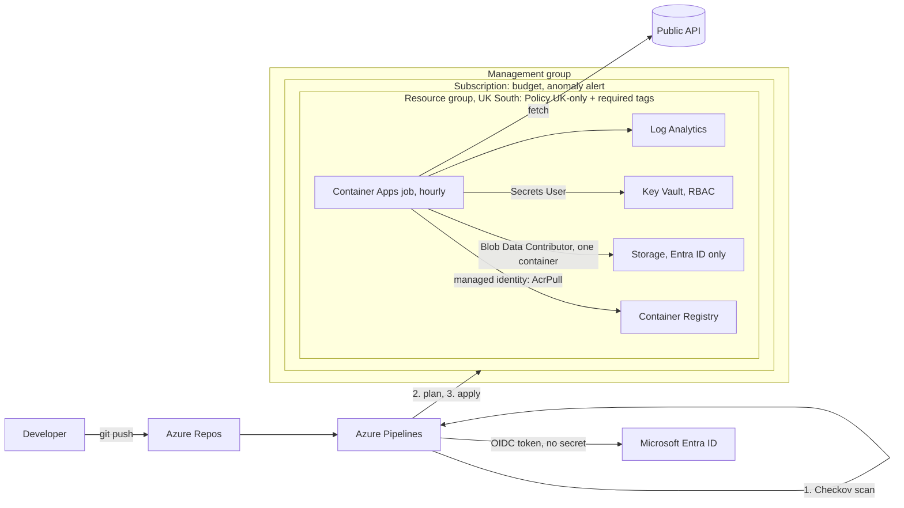

# Azure Platform Lab

Infrastructure as code for running a scheduled data job on Azure, built the way a platform team would:
Terraform, an Azure DevOps pipeline with no stored secrets, least-privilege identities, policy guardrails,
security scanning and cost controls.

It mirrors the production data job of my own platform, FPL Demon (fpldemon.com). The production job code is
private, so this repo uses an equivalent example job (UK bank holidays from gov.uk) with the same shape:
fetch, build, write, upload.

## Architecture

## What it demonstrates

| Area | How |
|---|---|
| Infrastructure as code | Everything in Terraform, remote state in Azure Storage with Entra ID auth |
| CI/CD | Azure DevOps YAML pipeline: Checkov scan, validate, plan, then apply the saved plan |
| No stored secrets | Pipeline uses workload identity federation (OIDC); the job uses a managed identity; registry admin login off; storage shared keys off |
| Least privilege | The job can only pull its image, write to one container and read secrets; the pipeline's admin rights are scoped to the lab resource group and management group |
| Governance | Azure Policy as code at management-group and resource-group level: UK-only locations, required `project` tag |
| Security scanning | Checkov fails the build on misconfigurations; accepted risks are skipped in code with a written reason |
| Cost control | Subscription and resource-group budgets with actual and forecast alerts, cost anomaly alerts, cost-allocation tags |
| Monitoring | Job logs and execution history in Log Analytics |

## Repository layout

| File | Contents |
|---|---|
| `main.tf` | Provider, budget, resource group, storage account, sample blob |
| `platform.tf` | Log Analytics, Container Registry, managed identity, role assignments, Container Apps environment and job |
| `keyvault.tf` | Key Vault with RBAC authorisation and scoped roles |
| `policy.tf` | Resource-group policy assignments |
| `managementgroup.tf` | Management group, subscription placement, management-group policy, pipeline roles |
| `costs.tf` | Resource-group budget, forecast alert, cost anomaly alert |
| `backend.tf` | Remote state (values supplied at init) |
| `azure-pipelines.yml` | The CI/CD pipeline |
| `job/` | The example job, its uploader (managed identity, no keys) and Dockerfile |

## Deploying it yourself

1. Create a storage account for state, copy `backend.hcl.example` to `backend.hcl` and fill it in.
2. Copy `terraform.tfvars.example` to `terraform.tfvars` and fill it in.
3. `terraform init -backend-config=backend.hcl`, then `terraform plan` and `terraform apply`.
4. Build and push the job image to the registry (`docker build`, `az acr login`, `docker push`).
5. In Azure DevOps, create a workload identity federation service connection and set the pipeline variables
   listed at the top of `azure-pipelines.yml`.

## Lessons learned

- **Grant the new access path before removing the old one.** Disabling storage shared keys broke the pipeline's
  plan (403) because its Entra ID data role was part of the same change. Bootstrapped the role, then split such
  changes into two stages.
- **Overlapping runs:** Terraform rejected a stale saved plan when two pipeline runs overlapped. Run one at a time.
- **Drift:** Azure added a default workload profile not in code; fixed by declaring it so plans are clean.
- **Free-trial limits:** ACR cloud builds are blocked, so the image is built locally and pushed.
- **Self-hosted agent quirks:** the agent had Windows PowerShell 5, so tasks use `scriptType: ps`.
