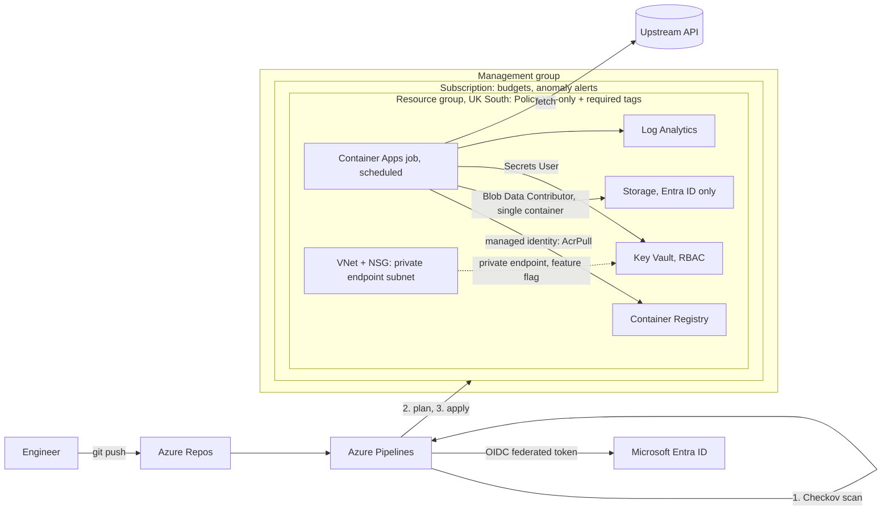

# Azure Platform: Infrastructure as Code

Azure infrastructure for the scheduled data pipeline behind [FPL Demon](https://fpldemon.com), a subscription
web platform. Everything is defined in Terraform and delivered through an Azure DevOps pipeline, with
identity-based access throughout, policy guardrails, security scanning and cost controls.

> The production job code is proprietary. This repository ships an equivalent reference job (UK bank holidays
> from gov.uk) with the same execution model: fetch, build, write, upload.

## Architecture

## Capabilities

| Area | Implementation |
|---|---|
| Infrastructure as code | Terraform (azurerm 4.x); remote state in Azure Storage with Entra ID authentication |
| Delivery | Azure DevOps YAML pipeline: security scan, validate, plan, apply of the reviewed plan artefact |
| Secretless authentication | Workload identity federation (OIDC) for the pipeline; user-assigned managed identity for the workload; registry admin user and storage shared keys disabled |
| Least privilege | Workload limited to image pull, write access to a single container and read-only secrets; pipeline administrative rights scoped to the platform resource group and management group |
| Governance | Azure Policy as code at management-group and resource-group scope: allowed locations (UK) and mandatory `project` tag |
| Security scanning | Checkov gate fails the build on misconfiguration; accepted risks are suppressed in code with documented justification |
| Cost management | Subscription and resource-group budgets with actual and forecast thresholds, cost anomaly alerts, cost-allocation tagging |
| Networking | Virtual network with NSG-protected private endpoint subnet; Key Vault private endpoint with `privatelink` private DNS zone, feature-flagged to control cost |
| Observability | Job execution history and console logs in Log Analytics |

## Repository structure

| Path | Purpose |
|---|---|
| `main.tf` | Provider configuration, subscription budget, resource group, storage account |
| `platform.tf` | Log Analytics, Container Registry, managed identity, role assignments, Container Apps environment and job |
| `keyvault.tf` | Key Vault with RBAC authorisation and scoped role assignments |
| `policy.tf` | Resource-group policy assignments |
| `managementgroup.tf` | Management group, subscription placement, management-group policy, pipeline role assignments |
| `network.tf` | Virtual network, subnet, NSG; Key Vault private endpoint and private DNS zone (`enable_private_networking`) |
| `costs.tf` | Resource-group budget, forecast alerting, cost anomaly alert |
| `backend.tf` | Remote state backend (configuration supplied at init) |
| `azure-pipelines.yml` | CI/CD pipeline |
| `job/` | Reference workload, managed-identity uploader and container definition |

## Deployment

1. Provision a state storage account, then copy `backend.hcl.example` to `backend.hcl` and complete it.
2. Copy `terraform.tfvars.example` to `terraform.tfvars` and complete it.
3. Run `terraform init -backend-config=backend.hcl`, `terraform plan` and `terraform apply`.
4. Build the workload image and push it to the registry (`docker build`, `az acr login`, `docker push`).
5. In Azure DevOps, create a workload identity federation service connection and define the pipeline variables
   listed at the top of `azure-pipelines.yml`.

## Verification

- **Private endpoint:** with `enable_private_networking = true`, the vault's private DNS record resolves to an
  address in the endpoint subnet (10.20.1.0/24) and the connection is auto-approved.
- **Policy:** deployments outside UK regions and resources without the `project` tag are denied at both
  management-group and resource-group scope.
- **Security scan:** Checkov runs on every pipeline run; any new failed check stops the build.

## Design decisions

- **Identity over credentials.** No secret, key or password is stored in code, pipeline variables or the
  workload. Access is granted through Entra ID role assignments at the narrowest workable scope.
- **Staged access changes.** When moving from shared keys to Entra ID, new role assignments are deployed and
  verified before legacy access is disabled, so no consumer loses access mid-change.
- **Plan as an artefact.** The apply stage executes the exact plan produced and reviewed in the plan stage, and
  Terraform rejects stale plans if state changes between stages.
- **Declared defaults.** Platform-managed defaults (for example the Container Apps consumption workload profile)
  are declared explicitly so that plans stay clean and real drift is visible.
- **Parallel migration.** The workload runs alongside the existing production pipeline, with outputs compared
  before cut-over.
- **Defence in depth.** Checkov blocks misconfigurations before deployment; Azure Policy enforces the same
  standards on anything created outside the pipeline.
- **Cost-aware features.** Paid components such as private endpoints sit behind feature flags so they can be
  enabled per environment rather than running permanently.
